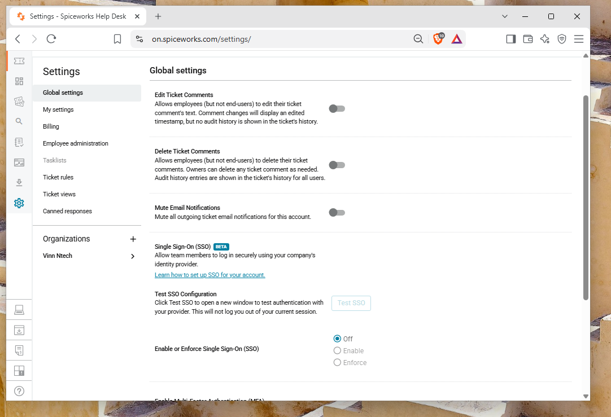
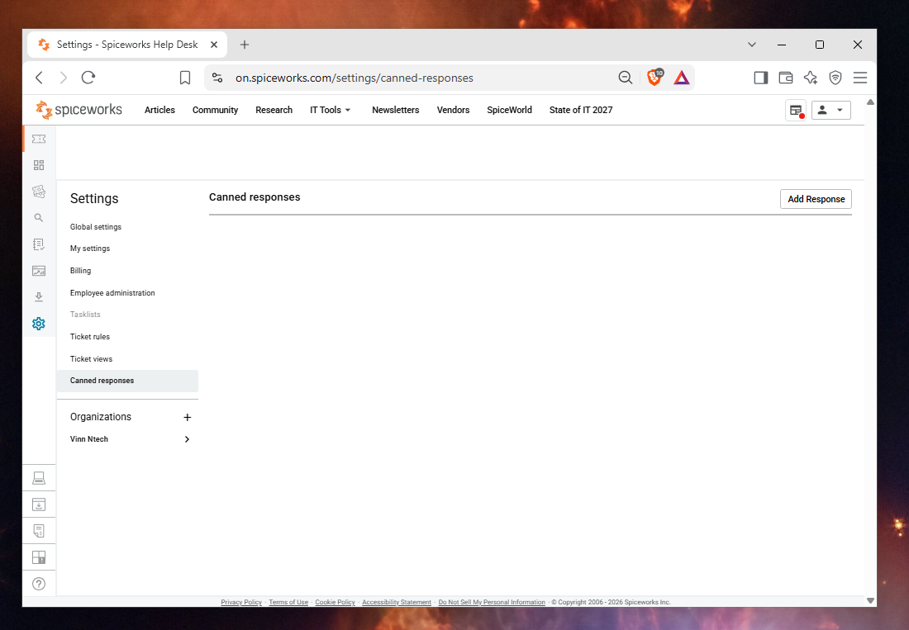
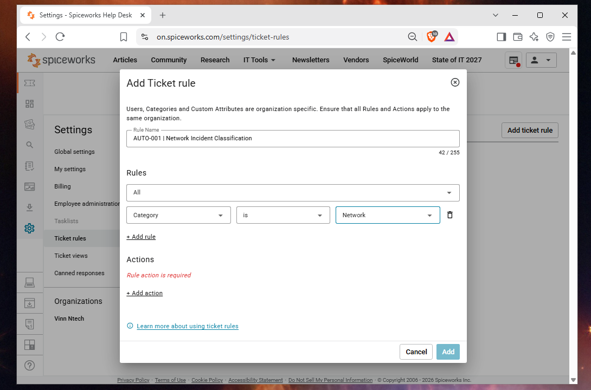
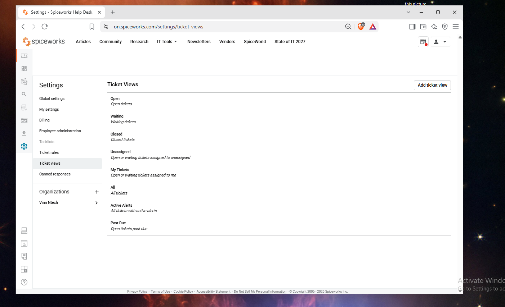

# Spiceworks Help Desk Setup and Configuration

## Objective

Establish a simulated IT service desk environment using Spiceworks Cloud Help Desk to gain hands-on experience with ticket management, user administration, workflow automation, ticket prioritization, and technical support documentation.

## Lab Environment

- **Ticketing Platform:** Spiceworks Cloud Help Desk
- **Organization:** Vinn Ntech (simulated)
- **Environment:** Web-based IT support lab
- **Role:** Help Desk Administrator / IT Support Technician
- **Test Data:** Fictional employees and support incidents

## Lab 01: Help Desk Configuration

### 1. Initial Setup

Configured a Spiceworks Cloud Help Desk environment to simulate internal IT support operations.

Reviewed administrative settings, employee management, ticket views, ticket rules, and notification preferences.

### 2. Employee Administration

Created fictional employee accounts to simulate a multi-user organization and test ticket assignment behavior.

This provided a controlled environment for testing support workflows involving different users.

### 3. Canned Responses

Created three standardized responses to improve consistency in help desk communications:

- **Initial Ticket Acknowledgment:** Confirms receipt of a support request.
- **Request Additional Information:** Requests information needed for troubleshooting.
- **Resolution Confirmation:** Requests confirmation that an issue has been resolved before closing the ticket.

### 4. Automated Ticket Assignment

Configured a ticket rule to automatically assign Network-related incidents to the designated IT support technician.

**Rule condition:** Category is Network

**Action:** Assign to Vinn Ntech

### 5. Troubleshooting Assignment Behavior

**Problem:** During initial testing, tickets outside the Network category appeared to be automatically assigned.

**Troubleshooting:** Added fictional employee accounts and continued testing ticket assignment behavior in the simulated environment.

**Verification:** Confirmed that Network tickets were automatically assigned while Hardware tickets remained unassigned.

**Result:** The intended category-specific assignment workflow operated correctly during subsequent testing.

### 6. Custom Ticket Views

Created a custom ticket view named **High Priority Incidents**.

Configured filters to identify tickets meeting the following conditions:

- Priority: High
- Status: Open

Verified that the custom view displayed two qualifying support tickets:

- Ticket #3: Internet connectivity issue
- Ticket #6: Screen flickering issue

### 7. Skills Demonstrated

- IT Service Desk Administration
- Incident Classification and Prioritization
- Automated Ticket Routing
- Employee Account Administration
- Ticket Queue Management
- Help Desk Communication
- Workflow Troubleshooting
- Technical Documentation

## Lab Outcome

Successfully configured and tested a simulated Spiceworks Cloud Help Desk environment, including employee accounts, canned responses, automated ticket assignment, and a custom high-priority ticket queue.

This lab provided practical experience with administrative workflows commonly used in Tier 1 IT Help Desk and IT Support environments.

**Note:** All incidents and employee accounts were created for educational simulation purposes.
